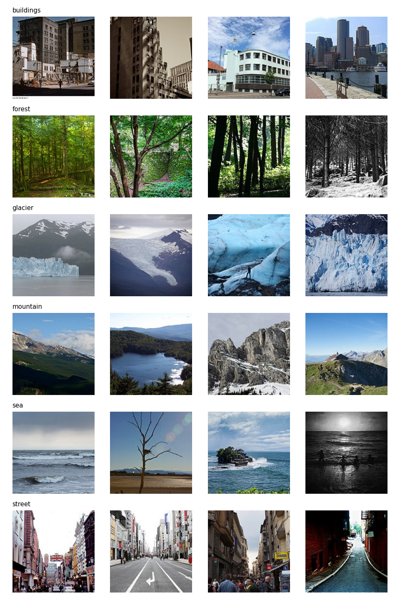

# Edge Image Classification

This project builds small image classifiers that could run on resource-constrained edge devices, such as microcontrollers, a Raspberry Pi or a phone. It was written for EN3150 Assignment 03.

We compare four models on the same data:

- **Model A**, a standard convolutional neural network (CNN), used as the baseline.
- **Model B**, a lightweight CNN built from depthwise separable convolutions, kept under 100,000 trainable parameters.
- **MobileNetV2** and **EfficientNetB0**, two well-known lightweight networks pretrained on ImageNet and fine-tuned on our data.

For each model we report test accuracy, precision, recall and the confusion matrix, along with the costs that matter on an edge device: parameter count, model size, compute per image and training time per epoch.




## The dataset

We use the [Intel Image Classification](https://www.kaggle.com/datasets/puneet6060/intel-image-classification) dataset from Kaggle. It contains about 17,000 photos of natural scenes in six classes: buildings, forest, glacier, mountain, sea and street. Most images are 150 by 150 pixels in colour.

Kaggle ships the data as two folders, seg_train and seg_test. We merge them and split every class again into 70% training, 15% validation and 15% test. Splitting each class separately keeps the class balance the same in all three parts. This gives 11,920 training images, 2,552 validation images and 2,562 test images.

The split is saved once in `results/split.csv`, so every model is trained and tested on exactly the same images. A fixed random seed (42) means the split can be recreated.

To imitate a low-resolution sensor, every image is resized to 64 by 64 pixels (the assignment's limit) and its pixel values are scaled to the range 0 to 1.

The images are not included in this repository because they are too large. Download the dataset from Kaggle and unzip it into a folder called `data` in the project root, so that the images sit in `data/seg_train/seg_train/<class name>/` and `data/seg_test/seg_test/<class name>/`.


## The models

**Model A (standard CNN).** Four convolution blocks with 32, 64, 128 and 128 filters. Each block is a 3×3 convolution, batch normalisation, a ReLU activation and 2×2 max pooling, which halves the image each time (64, 32, 16, 8, 4 pixels). After the last block, global average pooling turns each feature map into a single number. Then come dropout, a dense layer of 64 units and a final layer of 6 outputs with softmax. Model A has 250,182 trainable parameters and needs about 50.7 million multiply-accumulate operations per image.

**Model B (lightweight CNN).** The same layout as Model A, except that every convolution is depthwise separable. A depthwise separable convolution first applies one 3×3 filter to each input channel separately, then mixes the channels with a cheap 1×1 convolution. This gives roughly the same kind of feature extraction for a fraction of the cost. Model B has 38,113 trainable parameters, well under the 100,000 limit, and needs about 6.3 million multiply-accumulates per image, roughly 8 times fewer than Model A.

**Why ReLU.** ReLU only compares a value with zero, so it needs no exponentials or divisions. That makes it fast on simple hardware and easy to run with 8-bit integers. Softmax, which does need exponentials, is used only once, at the output.

**Why global average pooling.** Flattening the last feature maps into a dense layer would add over 130,000 weights. Global average pooling adds none.

**Pretrained models.** MobileNetV2 and EfficientNetB0 are loaded with their ImageNet weights, without their original classifier. A small new head (global average pooling, dropout of 0.2 and a 6-class output) is added on top. A rescaling layer converts our 0-to-1 pixels into the range each network expects.


## How training works, and why

Several choices in the training setup exist to make training stable and to reduce overfitting. They are worth knowing because they explain the shape of the training curves.

**Batch normalisation momentum of 0.9.** Batch normalisation keeps a running average of its statistics, which it uses at validation and test time. The default momentum of 0.99 makes that average lag far behind the weights while they are still changing quickly. That caused sudden spikes in the validation loss. A momentum of 0.9 lets the statistics keep up.

**Learning rate schedule.** If validation loss has not improved for 2 epochs, the learning rate is halved (Keras ReduceLROnPlateau). Large steps help early on. Smaller steps later stop the model from bouncing around the best point.

**Data augmentation.** During training only, each image is randomly flipped left to right, rotated by up to 18 degrees and zoomed by up to 10%. The model therefore never sees exactly the same picture twice, which makes memorising the training set harder. These layers switch off automatically during validation and testing, and they add no parameters. All four models use the same augmentation, so the comparison is fair.

**Dropout.** After global average pooling, dropout randomly turns off 30% of the features in Model A and 20% in Model B at each training step. The classifier therefore cannot rely on any single feature. The smaller model gets less dropout because it has less capacity to overfit.

**Keeping the best epoch.** After every epoch, the model is saved only if its validation loss is the best so far. The model tested at the end is therefore the one from the best epoch, not simply the last one.

**Early stopping.** If validation loss has not improved for 5 epochs, training stops and the best weights are restored. This rule only applies after epoch 20, so every run trains for at least the 20 epochs the assignment requires. It only matters if you choose to train for longer.

**Optimizers and learning rates.** Models A and B can each be trained with three optimizers: Adam, plain stochastic gradient descent (SGD), and SGD with momentum 0.9. Adam starts at a learning rate of 0.001, its standard default. Both SGD variants start at 0.01, because plain SGD needs larger steps.

All of these settings live in a table called `RUN_CONFIG` at the top of `src/train.py`. It holds the starting learning rate and the number of epochs for every model and optimizer pair, so you can change one run without touching the others. `src/sota.py` has a similar table for the two fine-tuning phases of each pretrained model.

**Fine-tuning the pretrained models** happens in two phases:

1. For 5 epochs, the pretrained backbone is frozen and only the new head trains, with a learning rate of 0.001.
2. For 15 epochs, the whole network is unfrozen and fine-tuned with a learning rate of 0.0001. The low rate adjusts the pretrained features without destroying them.

**Running on a CPU.** The code is set up for a computer without a graphics card. It turns on the oneDNN optimisations, which make training several times faster on a CPU. Images are decoded once and kept in memory, and the next batch is always prepared while the current one trains. A fixed seed is used everywhere, so runs can be repeated.


## Setting up (Windows, CPU only)

You need Python 3.10, 3.11 or 3.12. Open a terminal in the project folder (in PyCharm or VS Code, use the built-in terminal) and run:

```
python -m venv .venv
.venv\Scripts\activate
pip install tensorflow numpy matplotlib pillow
mkdir models
```

Always run the scripts from the project folder itself, not from inside `src`, because the scripts use relative paths such as `data/` and `results/`.

On macOS or Linux, activate the environment with `source .venv/bin/activate` instead.


## Running the project step by step

**Step 1. Look at the data (optional).** These scripts count the images per class, list the image sizes and save a grid of example images to `plots/samples.png`.

```
python src/check_data.py
python src/check_sizes.py
python src/view_samples.py
```

**Step 2. Create the split.** This writes `results/split.csv`. You only need to do it once; if the file already exists, skip this step so your results stay comparable.

```
python src/split_data.py
```

**Step 3. Quick checks (optional, a few seconds each).** Model B's check should end with "OK", confirming it is under 100,000 parameters. The data check should print batches of shape (32, 64, 64, 3) with values between 0 and 1.

```
python src/modelA.py
python src/modelB.py
python src/data.py
```

**Step 4. Train Models A and B.** The command takes the model (A or B) and the optimizer (adam, sgd or sgd_momentum). Run all six combinations:

```
python src/train.py B adam
python src/train.py B sgd
python src/train.py B sgd_momentum
python src/train.py A adam
python src/train.py A sgd
python src/train.py A sgd_momentum
```

To train one run for longer than its setting in `RUN_CONFIG`, add the number of epochs at the end, for example `python src/train.py A adam 40`.

Each run prints one line per epoch, including the learning rate in use. When it finishes, it saves three things:

- the best model, in `models/` (for example `models/B_adam.keras`)
- the loss, accuracy, learning rate and time of every epoch, in `results/` (for example `results/B_adam_history.json`)
- a picture of the training and validation curves, in `plots/` (for example `plots/B_adam_curves.png`)

**Step 5. Fine-tune the pretrained models.** The first run downloads the ImageNet weights, so you need an internet connection.

```
python src/sota.py mobilenetv2
python src/sota.py efficientnetb0
```

Each run tests its best model straight away. It saves its curves and confusion matrix in `plots/` and all its numbers in `results/` (for example `results/mobilenetv2_finetuned_metrics.json`).

**Step 6. Test Models A and B and build the comparison tables.**

```
python src/evaluate.py
```

This tests every model saved in `models/` on the test set. For each one it saves a confusion matrix picture in `plots/` (for example `plots/A_adam_confusion.png`). It also saves the accuracy, the precision and recall for every class, the parameter count, the compute per image, the model size and the average epoch time in `results/` (for example `results/A_adam_test_metrics.json`).

Finally, it gathers everything, including the pretrained models, into one file, `results/comparison.md`, with three tables:

- Model A against Model B
- all six optimizer runs side by side
- Model B against MobileNetV2 and EfficientNetB0

**Rough timings on a laptop CPU.** Model B takes about 10 to 15 minutes per run and Model A about 30 minutes. MobileNetV2 takes about 45 minutes and EfficientNetB0 about an hour. The first epoch of every run is slower because it also reads all the images. The reported average epoch time leaves that epoch out.


## Where to find everything

- `src/` holds all the code. Every file starts with a short description of what it does and how to run it.
- `data/` holds the dataset you download (not included in the repository).
- `results/` holds the split, the training histories, the test metrics and the comparison tables.
- `plots/` holds the training curves, confusion matrices and sample images.
- `models/` holds the trained models (not included in the repository because of their size).

The scripts in `src/` are:

- `check_data.py`, `check_sizes.py` and `view_samples.py` for inspecting the data
- `split_data.py` for creating the 70/15/15 split
- `data.py` for loading images, resizing and normalising them, and the augmentation
- `modelA.py` and `modelB.py`, which define the two custom models
- `train.py` for training Model A or B with a chosen optimizer
- `sota.py` for fine-tuning MobileNetV2 or EfficientNetB0
- `evaluate.py` for test-set evaluation and the comparison tables
- `plot_utils.py`, an optional helper for plotting curves interactively


## Results

The results are produced by the steps above and collected in `results/comparison.md`. They will be added here once the final training runs with the current code are complete.

For reference, an earlier run made before augmentation and dropout were added reached these test accuracies: Model A 89.2%, Model B 84.9% with Adam and 86.2% with SGD plus momentum, MobileNetV2 86.5% and EfficientNetB0 87.3%. Model B came within about 2 percentage points of the pretrained networks while being about 58 to 105 times smaller. These numbers will change with the current code.


## Reproducibility notes

- Every script uses the random seed 42.
- All models use the same split file, the same image size and the same augmentation.
- Epoch times depend on the computer, so compare times only between runs made on the same machine.
- Because oneDNN is turned on, results can differ very slightly from run to run.
